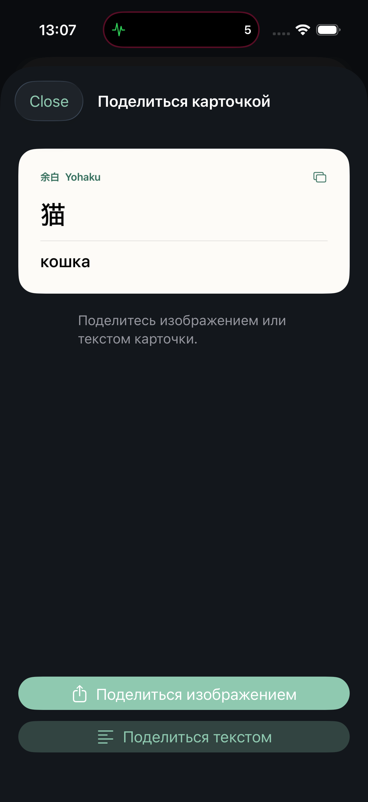
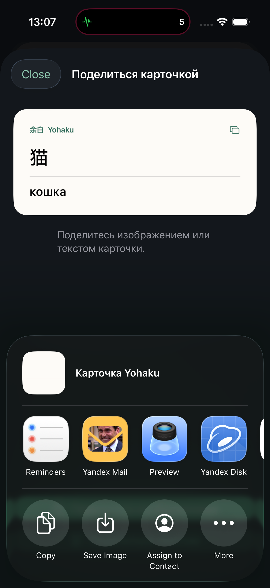

# Шеринг карточек: проверка 4 октября 2026

Карточкой можно поделиться из контекстного меню библиотеки, смахнув строку вправо, из редактора и из практики после раскрытия ответа. Предпросмотр предлагает изображение и, если слово и перевод введены текстом, текст. Изображение содержит обе стороны карточки, чтение, pitch accent, пример и заметку; рукопись сохраняется. Пути хранилища, исходные выдержки, аудиофайлы и история повторений в экспорт не входят. Шеринг не изменяет сохранённую карточку или прогресс.

Проверено на iPhone 17 Pro, iOS Simulator 26.2, схема Yohaku:

- Сборка успешна.
- `FlashcardSharingTests`: **3/3**. Проверены состав текста, исключение служебных данных, PNG шириной 1080 пикселей для рукописных карточек, отсутствие неполного текстового экспорта, длинные примеры и повреждённые данные рукописи.
- `testShareCardPreviewAndSystemSheetFromEditorAndPractice`: **1/1**. Проверены предпросмотр из редактора, системный шеринг изображения, возврат в библиотеку, отсутствие кнопки до раскрытия ответа, шеринг текста из практики и дальнейшая оценка той же карточки.
- PNG с текстом, рукописью и длинными полями просмотрены; длинный текст переносится без обрезки. Системное меню iOS 26 проверено как popover с закрытием нажатием снаружи.
- `git diff --check` прошёл. Полный набор тестов, iPad и Mac Catalyst в этой задаче не запускались.

Примеры экспорта: [слово](validation-assets/flashcard-shared-word.png), [рукопись](validation-assets/flashcard-shared-ink.png), [длинный текст](validation-assets/flashcard-shared-long.png).
