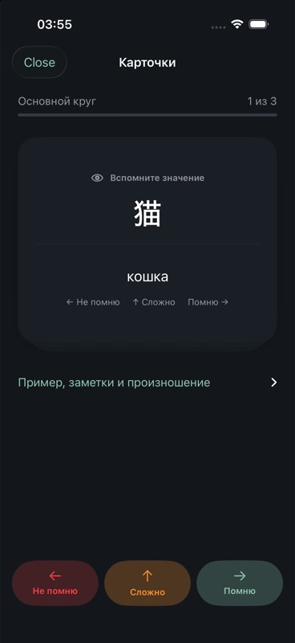

# Практика карточек: проверка 4 октября 2026

Изменения: три свайпа после раскрытия ответа, взвешенная выборка до 20 готовых карточек, автоматический второй круг ошибок и отдельный quiz с 2–4 различными переводами из словаря. Ошибки второго круга остаются к повторению; продолжение доступно кнопкой. Рукописные поля и прежние упражнения сохранены.

Проверено на iPhone 17 Pro, iOS Simulator 26.2, схема Yohaku:

- Сборка и запуск приложения успешны.
- Unit-набор: **68/69**. Все восемь новых тестов `FlashcardPracticeTests` прошли: направления и порог свайпа, очереди ошибок, восстановление интервала, приоритет и случайная выборка, варианты quiz, сравнение ответов, сохранение прогресса.
- Единственный сбой unit-набора: `pencilCanvasKeepsDocumentInkInLightAppearance()` — фактический `userInterfaceStyle` оказался `.dark` вместо `.light`. Код холста этой задачей не менялся. Полный unit-набор нельзя считать зелёным.
- Итоговый UI-прогон: **3/3** — `testSwipeRatingsAndSecondRoundOfMistakes`, `testQuizIncorrectChoiceReturnsInSecondRound`, `testHandwrittenVocabularyCardCanBeEditedAndStudied`.
- `git diff --check` прошёл.

UI-прогон проверяет отсутствие оценки до раскрытия ответа, все три направления, повторную ошибку и ручной третий круг, неверный выбор в quiz и его последующее исправление, создание и редактирование рукописной карточки. В процессе устранены перекрытие идентификатора вопроса идентификатором контейнера и конфликт вертикального свайпа с прокруткой. Карточка теперь находится вне прокручиваемой области; ввод, варианты и подробности расположены ниже.

Этот прогон подтверждает поведение в iPhone Simulator. Физический Apple Pencil, iPad и Mac Catalyst отдельно в этой задаче не проверялись.
