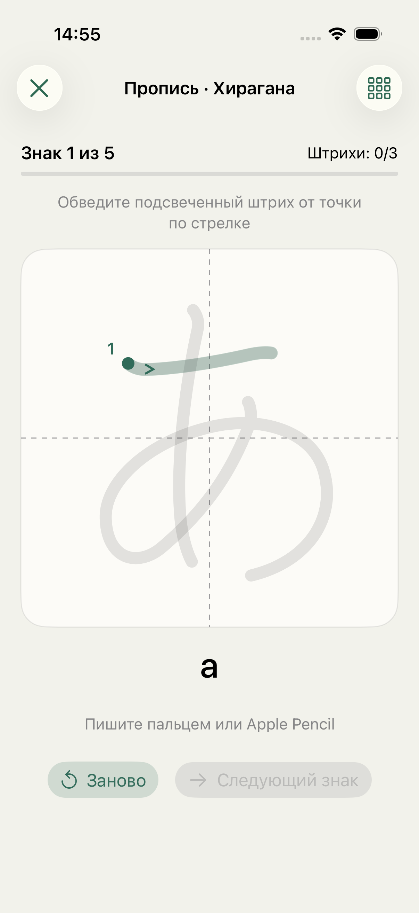
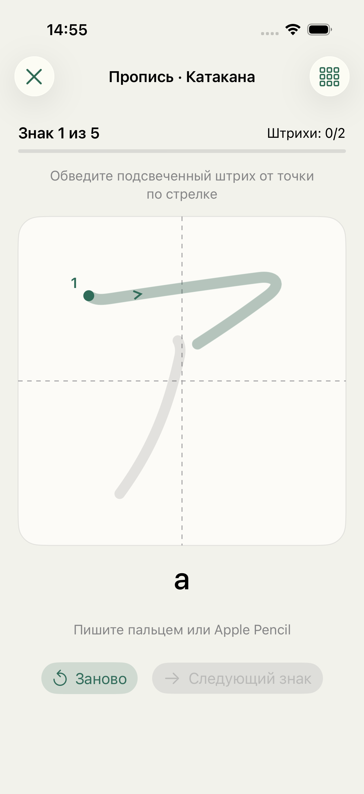
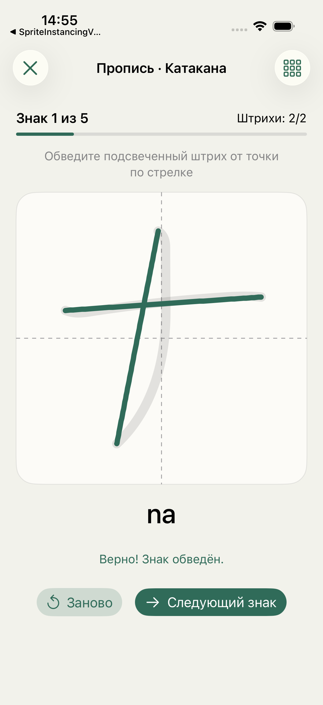

# Пропись хираганы и катаканы

В разделе «Изучение» доступны два отдельных задания, даже если библиотека слов пуста. Каждый алфавит содержит 46 базовых знаков, разбитых на десять рядов. Ряд можно выбрать в меню справа вверху.

На поле виден бледный образец знака. Текущий штрих подсвечен, его начало отмечено точкой и номером, направление — стрелкой. Под полем показано чтение в ромадзи. Писать можно пальцем или Apple Pencil. Проверка после отпускания учитывает начало, конец, длину, форму и направление штриха; следующий штрих принимается только в установленном порядке. Неверная обводка остаётся оранжевой до следующей попытки или сброса. Переход к следующему знаку доступен после всех правильных штрихов. «Заново» очищает текущий знак, смена ряда начинает новое задание. Прогресс относится к текущему сеансу.

Эталоны работают без сети. `App/KanaTemplates.json` получен из закреплённой версии [KanjiVG](https://github.com/KanjiVG/kanjivg/tree/70a0b7ae0c18ceb5cb358274b029cce0234a43bc); источник и лицензия указаны в меню задания и `THIRD_PARTY_NOTICES.md`. Генератор: `python3 Validation/generate-kana-templates.py`.

Проверено 10 октября 2026 года:

- Сборка и отдельный запуск Yohaku в iPhone 17 Pro Simulator, iOS 26.3.1, через XcodeBuildMCP — успешно. Временный каталог сборки: `/tmp/yohaku-kana-derived`.
- `KanaTracingTests`, существующие `FlashcardPracticeTests` и `KanaTracingUITests`: 13/13 тестов прошли. Все 212 эталонных штрихов и небольшие отклонения принимаются; обратное направление, неверный порядок, точки, укороченные линии и каракули отклоняются.
- Два UI-теста повторно прошли при сохранении скриншотов. Подтверждены оба задания при пустой библиотеке, сброс, правильная обводка первого штриха あ, полная обводка ナ, блокировка/разблокировка перехода, очистка при переходе и смене ряда. Вертикальный штрих не прокручивает страницу.
- Скриншоты визуально проверены: поле, чтение и кнопки помещаются на экран, состояние успеха видно. Физический Apple Pencil и iPad в этой проверке не использовались.

